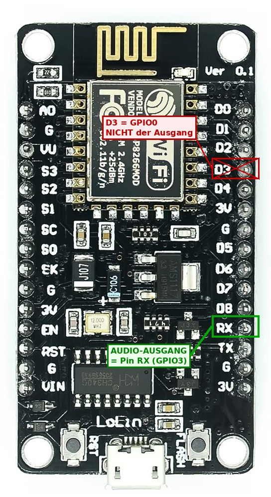
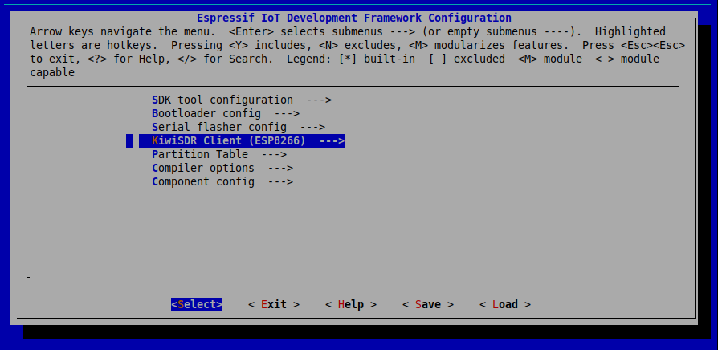
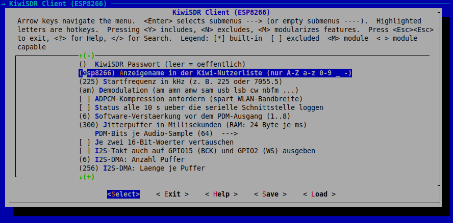

# KiwiSDR Client for the **ESP8266** (PDM Output via I2S)

A standalone port of the KiwiSDR client (ESP32 version: https://github.com/radiolab81/ESP32_KiwiSDR) to the ESP8266.
The chip has **no DAC**; the audio is therefore output as a **1-bit density stream (delta-sigma / PDM)**
via the I2S block and smoothed into an analog signal by an RC filter at the pin.
The protocol core (WebSocket, KiwiSDR protocol, ADPCM) is **the same source code** as on the ESP32 and the PC;
only what the ESP8266 strictly requires was changed (see Section 3).


---

## 1  Is the Port Feasible? – Assessment Results

**Yes, with three limitations.**

| Question | Result |
|---|---|
| Does the protocol core run on the ESP8266? | Yes. Pure C, using only BSD sockets (lwIP) and `stdio`. Two changes: no C11 atomics (the Xtensa L106 core has no atomic instruction), and 2 KB buffers instead of 4–6 KB. |
| Is there an output option without a DAC? | Yes: an I2S DMA bitstream with a delta-sigma modulator, on pin **GPIO3**. The SDK provides an I2S driver (`i2s_driver_install`, `i2s_write`, 16-bit). |
| Is the audio quality sufficient? | Yes. Measured on the bitstream (tone at 0.24 of full scale): **53 dB** SNR in the 0–5 kHz band at 64 bits/sample, **46 dB** at 32 bits/sample. An 8-bit DAC theoretically achieves about 38 dB at this level, and a shortwave signal itself usually only has 30–50 dB. |
| Limitation 1: **GPIO3 = RX0** | Serial *input* is unavailable while audio is running. The console (frequency/mode) therefore runs over **TCP** (`nc <ip> 2323`). Serial *output* (logs, TX = GPIO1) works normally. |
| Limitation 2: **RAM** | Only about 50 KB of heap is free. Buffers are small (ring buffer 300 ms = 8 KB). ADPCM needs more buffer because of its large 170 ms blocks (see Section 5). |
| Limitation 3: **CPU** | 64 bits/sample cost roughly 15–20 % at 80 MHz (estimate, not measured on the chip). Headroom: 32 bits/sample or 160 MHz. |

---

## 2  Circuit

```
              3.3 kΩ              10 µF
 GPIO3 ───────/\/\/\──────┬───────||───────►  Amplifier / active speaker
 (RX0, I2S data)          │   (electrolytic cap)
                        10 nF
                          │
                         GND
```

* Low-pass filter at approx. 5 kHz (3.3 kΩ · 10 nF → f = 1/(2π·R·C) ≈ 4.8 kHz). It removes the bit clock (1.5 MHz).
* The series electrolytic capacitor removes the DC component (the idle level is approx. 1.65 V).
* **GPIO3 is the serial receive pin.** A connected USB-to-serial adapter does not disturb the output,
  because it is only needed for reading the logs (TX); disconnect the audio output briefly when flashing.
* During boot, GPIO15 (LOW) and GPIO2 (HIGH) are held at fixed levels; they are **not** used (I2S clock off).


---

## 3  Changes Compared to the ESP32 Version

| Area | ESP32 | ESP8266 (this package) | Reason |
|---|---|---|---|
| Audio output | `dac_continuous` (8-bit) | `kiwi_pdm.c` + I2S (`sink_pdm.c`) | no DAC |
| Ring buffer | FreeRTOS StreamBuffer | custom ring (1 producer / 1 consumer) | simpler, single core |
| Clock drift | 1 s buffer | **Clock correction** (±1 output sample) + 300 ms buffer | I2S clock from integer dividers is inaccurate |
| Console | UART | **TCP console** (`net_console.c`) | GPIO3 carries the audio |
| Wi-Fi API | `esp_netif` / `esp_event` | `tcpip_adapter` / `esp_event_loop_init` | SDK generation |
| Event flag | C11 atomics | `kiwi_flag_*` (interrupt lock) | L106 has no CAS |
| Sockets | POSIX names | `lwip_*` names (`K_*` macros in the port) | reliably available in the SDK |
| Time/random | `clock_gettime`, `esp_random` | FreeRTOS tick, `esp_random` | – |
| `KIWI_RX_BUF_SIZE` | 4096 (ESP32: 6144 possible) | 2048 | RAM; sufficient for 1034-byte frames |
| Build | CMake (ESP-IDF 6.1) | `make` / CMake (ESP8266_RTOS_SDK v3.x) | different SDK |

Unchanged: `kiwi_ws.c`, `kiwi_adpcm.c`, `kiwi_client.c` (except for four lines for the flag), all headers.

---

## 4  Building and Flashing

Prerequisite: **ESP8266_RTOS_SDK** (v3.x, e.g. v3.4) with the `xtensa-lx106-elf` toolchain, set up according to the Espressif guide.

```sh
export IDF_PATH=~/ESP8266_RTOS_SDK
cd kiwi-esp8266
make menuconfig            # Menu "KiwiSDR Client (ESP8266)": Wi-Fi, host, frequency, mode, gain ...
make -j4 flash monitor     # or: idf.py build flash monitor  (CMake, from SDK v3.3)
```


### Operation (Console over Wi-Fi)

```sh
nc 192.168.1.50 2323       # The IP is shown in the log ("sta ip: ...")
> f 1008                   # Frequency in kHz
> m usb                    # Mode: am amn amw sam sal sau lsb lsn usb usn cw cwn nbfm nnfm
> s                        # Status
> q                        # End session (the chip reconnects after 5 s)
```

**Caution:** The console has **no authentication**. Anyone on the Wi-Fi network can change the frequency/mode. It can be disabled in `menuconfig`.

---

## 5  Commissioning and Fine-Tuning






1. **Listening test without network:** In `menuconfig`, enable "Listening test at startup". Before Wi-Fi starts, the chip plays a
   1 kHz tone for 5 s. You should hear a **clean sine tone**. Noise/crackling → check the circuit.
2. **Bit order (`KIWI_PDM_SWAP_WORDS`):** The I2S block sends two 16-bit words per frame. A wrong setting merely swaps adjacent
   16-bit blocks: the tone remains audible but is somewhat noisier. Compare both settings in the listening test and keep the
   one with the clean tone.
3. **Crackling/dropouts:** Check the log line `Ring ueber/unter` (ring overflow/underflow). For underruns → increase `KIWI_PDM_BUFFER_MS` or enlarge the DMA buffers
   (`KIWI_PDM_DMA_COUNT/LEN`). Persistently high correction counts (`+`/`-` in the thousands per minute) are normal with
   clock drift; underruns/overruns should remain 0.
4. **Heap:** The log reports `Heap frei` (free heap). If it stays below approx. 10 KB, reduce the buffers.
5. **ADPCM:** An ADPCM frame contains 2048 samples (170 ms) and arrives as one block. In this case, set `KIWI_PDM_BUFFER_MS` ≥ 600
   (approx. 16 KB RAM). Raw PCM (default) delivers a frame every 43 ms and requires approx. 24 kB/s of bandwidth.
6. **`xTaskCreate` fails / reset at startup:** I have not confirmed the unit of the stack size (bytes or words) for the
   ESP8266 SDK. The values (4096 Kiwi task, 2560 audio task, 3072 console) are intended as bytes; if the unit is words,
   divide them by 4 accordingly.

7. **No sound, `Ring ueber` (ring overflow) grows in the log, `unter` (underrun) and `Korrektur` (correction) remain 0:** The audio task is stalled. The cause is
   almost always that the **I2S DMA does not return buffers**. According to the SDK source (`driver/i2s.c`), `i2s_write()`
   obtains free DMA buffers only via a queue into which the DMA interrupt routine places buffers that have finished playing. If the interrupt does not arrive, `i2s_write()` waits forever with `portMAX_DELAY` (similar reports:
   SDK tracker issue #981). The firmware therefore never waits longer than 200 ms at a time, counts timeouts, and
   resets in stages (`i2s_stop/start`, then reinstalling the driver). The log shows this as
   `I2S Aufrufe … Zeitueb. … Neustarts … Bytes …` (I2S calls … timeouts … restarts … bytes …):
   * `Zeitueb.` stays 0 and `Bytes` grows → I2S is running, the problem lies elsewhere.
   * `Zeitueb.` grows, `Bytes` stays ≈ 0, `Neustarts` > 0 → the DMA does not start on this board/SDK version.
     In that case, please first run the **listening test without Wi-Fi** (`KIWI_PDM_SELFTEST`): at the end it reports either
     `I2S-Treiber ok` (I2S driver OK) or `I2S-Treiber haengt!` (I2S driver hangs!) together with the counters. If it hangs **without** Wi-Fi, the cause is the I2S driver
     of this SDK version; if it is OK without Wi-Fi but hangs **with** Wi-Fi, the cause is an interaction with the radio subsystem.

   **Observation on the test device (SDK v3.4-115, ESP8266EX, 2 MB flash):** The listening test *before* Wi-Fi startup reported
   "I2S driver hangs" (24 calls, 24 timeouts, 0 bytes, even after reinstallation), whereas the Kiwi session
   *after* Wi-Fi startup ran flawlessly (5062 calls, 0 timeouts, 1.26 MB in 6.5 s ≈ 194 KB/s,
   exactly the nominal rate). In the SDK source, the I2S DMA does not visibly depend on Wi-Fi; the cause remains unexplained. The
   listening test therefore now runs once **after** Wi-Fi startup, where normal operation also takes place.
8. **`Sitzung beendet: … [Server-Meldung: …]` (session ended: … [server message: …]):** The message now states the exact cause reported by the Kiwi:
   `too_busy=N` = all N client slots are occupied; `badp=5` = **no multiple connections from the same IP**; `badp=6` =
   database update (wait 1 minute); `badp=1` = wrong password or all password-free channels occupied.
   **Note:** The Kiwi often sees clients in the same home network under the **same IP** (router/NAT). If another
   device (browser tab, PC client, the ESP32) is running at the same time, one of them will receive `badp=5`. Operate only **one** client at a time,
   including during testing.

**Memory budget (estimate, not measured):** client structure approx. 3.5 KB (static) + ring buffer 8 KB + I2S DMA (depending on the
SDK 1.5–8 KB) + task stacks approx. 10 KB ⇒ approx. 25 KB of the approx. 50 KB free heap.

---

## 6  The KiwiSDR Audio Protocol (Summary)

The analysis is based primarily on `kiwi/client.py` (`KiwiSDRStream`),
`kiwi/wsclient.py` (handshake), and `kiwirecorder.py` (startup sequence).

### 6.1 Transport: WebSocket on the HTTP Port

1. TCP connection to `host:8073`.
2. `GET /ws/kiwi/<timestamp>/SND HTTP/1.1` with `Upgrade: websocket`,
   `Origin: http://host:port`, `Sec-WebSocket-Key`, `Sec-WebSocket-Version: 13`.
   **The path prefix `/ws/kiwi` is mandatory on KiwiSDR v1.9xx** (verified by a browser capture
   against v1.902). With the old path `/<timestamp>/SND` (as used in the bundled
   `kiwiclient`), the server does respond with `101`, but then **never sends a byte** –
   this was the cause of the initial timeout. For older Kiwis: `kiwi_pc -l`
   or `path_prefix = ""`.
   The timestamp is an arbitrary number that differs for each connection. `SND` selects the
   audio channel (`W/F` would be the waterfall).
3. Response `101 Switching Protocols`. (`Sec-WebSocket-Accept` is not verified – as in the
   Python client.)
4. Client→server frames are **masked** (mandatory); server→client frames are not.

### 6.2 Control Channel: `SET …` Text Commands and Server `MSG`

| Direction | Message | Meaning |
|---|---|---|
| C→S | `SET auth t=kiwi p=<password>` (without password: `p=#`) | Authentication (immediately after the handshake) |
| C→S | `SERVER DE CLIENT kiwi_esp32 SND` | Self-identification (the browser sends this as well) |
| S→C | `MSG sample_rate=11998.895009` | arrives as the **first** message on v1.902: actual rate, channel ready |
| S→C | `MSG badp=0`, `MSG version_maj=1 version_min=902 …` | Authentication OK, version |
| S→C | `MSG audio_init=0 audio_rate=12000` | nominal audio sampling rate |
| C→S | `SET AR OK in=12000 out=44100` | **Mandatory acknowledgment**, otherwise no audio starts |
| C→S | `SET squelch=0 max=0`, `SET genattn=0`, `SET gen=0 mix=-1` | neutral default values |
| C→S | `SET ident_user=<name>` | Display name |
| C→S | **`SET mod=am low_cut=-4900 high_cut=4900 freq=225.000`** | **Tuning**: mode, passband (Hz), frequency in **kHz** |
| C→S | `SET agc=1 hang=0 thresh=-100 slope=6 decay=1000 manGain=50` | AGC |
| C→S | `SET compression=0` | raw PCM instead of ADPCM (optional) |
| C→S | `SET keepalive` | at least once per second, otherwise disconnection |
| S→C | `MSG too_busy=…`, `badp=1..7`, `down=…`, `redirect=…` | Errors |

`MSG` messages have the format `MSG<1 separator byte>name=value name=value …`.
Some of them (`load_cfg`, `load_dxcfg`) are tens of thousands of bytes in size and unnecessary for
audio reception – the client **discards** messages that do not fit into the
buffer (important for the RAM-constrained ESP32).

For a Kiwi with a frequency offset (up-converter, `freq_offset=`), the protocol expects
the *baseband* frequency = displayed frequency − offset; the client handles this
automatically.

### 6.3 Audio Frames: `SND`

```
Offset  Length  Content
0       3       "SND"
3       1       flags: 0x02 ADC overflow, 0x08 stereo (IQ/DRM), 0x10 ADPCM, 0x80 LE (only "camp")
4       4       Sequence number, little endian
8       2       S-meter, big endian:  RSSI[dBm] = 0.1 · value − 127
10      …       Audio data
```

* On v1.902, a frame always contains 1024 payload bytes: **ADPCM = 2048 samples (≈ 171 ms)**,
  **raw PCM = 512 samples (≈ 43 ms)** (measured on the ESP32 with raw PCM: approx. 23 frames/s).
  `KIWI_RX_BUF_SIZE` = 6144 offers ample headroom.
* **Raw (`flags&0x10 == 0`):** `int16`, **big endian**, mono.
* **ADPCM (`flags&0x10`):** IMA-ADPCM, 1 byte = 2 samples (**low nibble first, then
  high nibble**). The decoder (predictor + step index) carries over across all frames
  of the connection.
* The **first** SND frame may still contain audio from the channel's previous user. It is
  decoded (so that the ADPCM state is correct) but not output.
* Between the SND frames, `MSG user_cb=…`, `stats_cb=…` and the like (JSON,
  ignored by the client) as well as large `load_cfg=…` messages (which are skipped) arrive continuously.
* Gaps in the sequence number = lost frames (these are counted).

### 6.4 Termination

Send a WebSocket close frame (status 1001), let the connection drain briefly, then close the TCP connection.
(If the socket were simply closed with unread data pending, Linux would send a
TCP RST and the server might lose the close frame – the PC test uncovered exactly this,
which is why `kiwi_client_close()` keeps reading for another ≤ 300 ms.)

---


---

---

## 7  Files

```
kiwi-esp8266/
├── Makefile, CMakeLists.txt, sdkconfig.defaults
├── components/kiwi_core/        portable core (PC + ESP8266), component.mk + CMakeLists.txt
│   ├── include/  kiwi_client.h kiwi_ws.h kiwi_adpcm.h kiwi_port.h kiwi_audio_sink.h kiwi_pdm.h
│   └── src/      kiwi_client.c kiwi_ws.c kiwi_adpcm.c port_sockets.c kiwi_pdm.c
├── main/                        ESP8266 only
│   ├── app_main.c   Wi-Fi, Kiwi task, startup       sink_pdm.c/.h   I2S bitstream output + clock correction
│   ├── net_console.c/.h  TCP console                Kconfig.projbuild  all settings
│   └── app_dir.c/.h  dir_store_flash.c/.h   Server directory: update task, NVS, switching, flash store
├── partitions.csv               Partition table with "kiwidb" (server directory, 2 x 192 KB)
├── components/kiwi_dir/         portable directory service (DB, parser, HTTP, country mapping, "d" commands)
└── pc/                          Tests and PC client (run without an ESP8266)
    ├── test_core.c  test_pdm.c  sim_sink_pdm.c  e2e_test.py  mock_kiwi.py  main_pc.c  sink_wav.c  Makefile
    ├── test_dir.c  e2e_dir_test.py  kiwi_dirtool.c  store_file.c/.h  testdata/   (directory service)
    └── sim/                     Substitute headers (FreeRTOS, I2S) for simulating main/sink_pdm.c
```


---

## 8  Server Directory: Loading the List, Filtering by Country, Switching Servers

Identical to the ESP32 version (same sources in `components/kiwi_dir`), adapted to the ESP8266.
The list `http://rx.linkfanel.net/kiwisdr_com.js` (approx. 0.9 MB, ~840 servers) is parsed
on reception and stored as a compact database (120 bytes/server) in the flash partition `kiwidb`
(two slots A/B: an aborted update never destroys the old list). If an entry lacks the port, **8073** applies.

### Operation (TCP Console: `nc <ip> 2323`)

| Command | Effect |
|---|---|
| `d` | Help |
| `d update` | Load the list and renew the database (`d update force` ignores the minimum interval) |
| `d info`, `d countries` | Database status, countries with server counts |
| `d filter <country>` / `d free` / `d snr <dB>` / `d freq <kHz>` | Set filters (combinable) |
| `d list` | Show matches |
| `d go <no.>`, `d go best`, `d go host[:port]` | Switch server (the session is re-established; the selection persists across restarts in NVS) |

Example: `d update` → `d filter Switzerland` → `d list` → `d go 142`.
If the selected server reports "busy/down/password" and no audio was received, the client automatically selects the
next match of the filter with a free channel (`KIWI_DIR_FAILOVER`, menu "Server directory").

### What Differs on the ESP8266 (Compared to the ESP32)

| Topic | ESP8266 solution |
|---|---|
| Atomics | no C11 atomics (L106): `kiwi_flag` of the port layer or `volatile int` |
| RAM (~50 KB heap) | Update context approx. 3.7 KB (instead of 9 KB) on the heap only during the update; parser fields 128 instead of 240 bytes, country table 96 instead of 255 entries (`KIWI_DIR_VAL_W`, `KIWI_DIR_WRITER_COUNTRIES` in `component.mk`) |
| **Audio pauses during the update** | `d update` ends the running session (freeing its memory), loads the list (approx. 10–40 s), and then reconnects automatically. This is intentional: running both in parallel would exceed the available RAM. |
| Flash access | The ESP8266's SPI flash requires 4-byte alignment; `dir_store_flash.c` uses a 64-byte intermediate buffer for unaligned accesses |
| Console output | `net_console_write()` sends multi-line output directly to the TCP client (the 200-byte reply buffer would be too small); line buffer 80 instead of 48 bytes |
| Flash size | `partitions.csv` requires ≥ 2 MB (ends at 0x170000), set in `sdkconfig.defaults` |

### Integrating into / Updating an Existing Project

`sdkconfig.defaults` only takes effect for a **new** `sdkconfig`: `rm sdkconfig` (or in `make menuconfig`:
Partition Table → Custom, filename `partitions.csv`, Flash size 2 MB), then `make flash`.
The partition table is rewritten during flashing; Wi-Fi/NVS data are not preserved in the process.

### Tests on the PC

`cd pc && make test` – additionally includes `test_dir` (also with the small ESP8266 profile as `test_dir_small`)
and `e2e_dir_test.py` (local HTTP mock: redirect, chunked, error pages, capacity).
Example: `./kiwi_dirtool -d kiwidb.bin -f testdata/kiwisdr_sample.js "d update" "d filter Germany" "d list"`.

Live connections of the client to several real KiwiSDR servers (different firmware versions, locations, load) were successful.

## 9  Target Audience and Motivation

There are already plenty of clients for KiwiSDR and WebSDR on the PC (browsers,
`kiwiclient`, various desktop programs). This project deliberately targets a
different area: **embedded devices that are meant to use a remote
SDR as an "antenna and receiver from the network" without operating-system overhead.**

Typical applications:

* **Upcycling and retrofitting** of old tube, transistor, or world-band radio enclosures,
  which tap into a remote KiwiSDR instead of having their own RF section
  (see, for example, the
  [element14 UpCycleIT project "Embedded Web-SDR Client on Analog Radio Receiver"](https://community.element14.com/challenges-projects/design-challenges/upcycleit/b/blog/posts/upcycle-it-design-challenge-embedded-web-sdr-client-on-analog-radio-receiver-1-introduction)).
* **Low-power always-on devices**, e.g. kitchen, workshop, or bedside radios,
  battery or solar operation.
* **Teaching and hobbyist projects** around radio, WebSockets, and embedded audio with
  manageable, readable C code.
* **Reception in places without a good antenna of your own** (rented apartments, dead-zone locations), using a
  selected Kiwi in a low-noise area.

**Why not a Raspberry Pi or Jetson with a headless browser?**
The usual way to build a web SDR into a device is a single-board computer
with a (headless) browser. For the task of "receiving and outputting an audio stream"
this is heavily oversized: Linux boot, several hundred MB of RAM, high
power consumption and long startup times, plus maintenance effort (updates, SD card wear).
An ESP8266 (or a comparable MCU with Wi-Fi) accomplishes the same task with
a few hundred KB of RAM, starts in seconds, and typically needs only a
fraction of the power.

**Scope – what the project does not aim to be:**
Not a replacement for the complete web interface (no waterfall, no DX list,
no wideband IQ processing). It is about the audio of a single channel.

---
