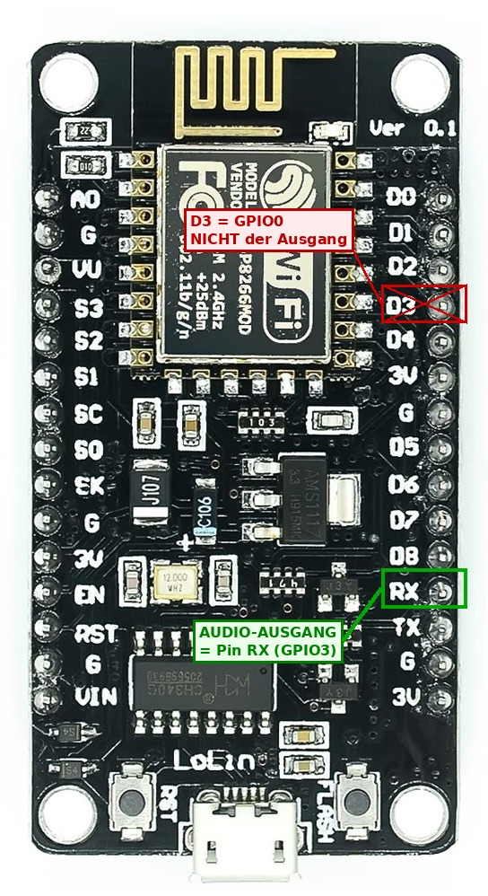
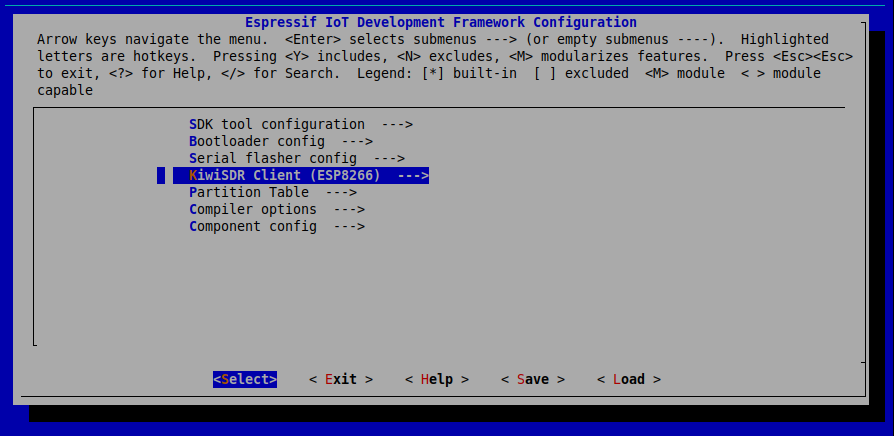
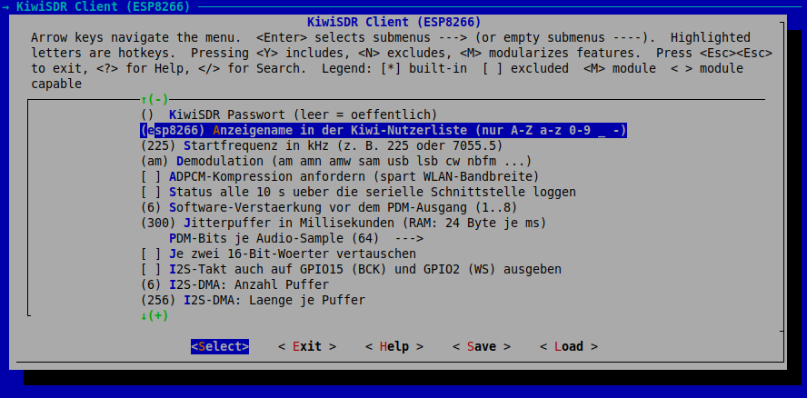

**Deutsch** · [English](README.en.md)

# KiwiSDR-Client für den **ESP8266** (PDM-Ausgang über I2S)

Eigenständige Portierung des KiwiSDR-Clients (ESP32-Version: https://github.com/radiolab81/ESP32_KiwiSDR) auf den ESP8266.
Der Chip hat **keinen DAC**; das Audio wird deshalb als **1-Bit-Dichtestrom (Delta-Sigma / PDM)**
über den I2S-Block ausgegeben und mit einem RC-Glied am Pin zu Analogsignal geglättet.
Der Protokoll-Kern (WebSocket, KiwiSDR-Protokoll, ADPCM) ist **derselbe Quellcode** wie bei ESP32 und PC;
geändert wurde nur, was der ESP8266 zwingend verlangt (siehe Abschnitt 3).


---

## 1  Ist die Portierung machbar? – Ergebnis der Prüfung

**Ja, mit drei Einschränkungen.**

| Frage | Ergebnis |
|---|---|
| Läuft der Protokoll-Kern auf dem ESP8266? | Ja. Reines C, nur BSD-Sockets (lwIP) und `stdio`. Zwei Änderungen: keine C11-Atomics (der Xtensa-L106-Kern hat keinen atomaren Befehl), Puffer 2 KB statt 4–6 KB. |
| Gibt es eine Ausgabe ohne DAC? | Ja: I2S-DMA-Bitstrom mit Delta-Sigma-Modulator, am Pin **GPIO3**. Das SDK hat einen I2S-Treiber (`i2s_driver_install`, `i2s_write`, 16 Bit). |
| Reicht die Audioqualität? | Ja. Gemessen am Bitstrom (Ton 0,24 Vollaussteuerung): **53 dB** SNR im Band 0–5 kHz bei 64 Bit/Sample, **46 dB** bei 32 Bit. Ein 8-Bit-DAC erreicht bei diesem Pegel rechnerisch ca. 38 dB, ein Kurzwellensignal hat selbst meist nur 30–50 dB. |
| Einschränkung 1: **GPIO3 = RX0** | Die serielle *Eingabe* fällt weg, solange Audio läuft. Die Konsole (Frequenz/Modus) läuft deshalb über **TCP** (`nc <ip> 2323`). Serielle *Ausgabe* (Logs, TX = GPIO1) funktioniert normal. |
| Einschränkung 2: **RAM** | Nur ca. 50 KB Heap sind frei. Puffer sind klein (Ring 300 ms = 8 KB). ADPCM braucht wegen großer 170-ms-Blöcke mehr Puffer (siehe 5). |
| Einschränkung 3: **CPU** | 64 Bit/Sample kosten grob 15–20 % bei 80 MHz (Schätzung, nicht am Chip gemessen). Reserve: 32 Bit/Sample oder 160 MHz. |

---

## 2  Schaltung

```
              3,3 kΩ              10 µF
 GPIO3 ───────/\/\/\──────┬───────||───────►  Verstärker / aktiver Lautsprecher
 (RX0, I2S-Daten)         │      (Elko)
                        10 nF
                          │
                         GND
```

* Tiefpass ca. 5 kHz (3,3 kΩ · 10 nF → f = 1/(2π·R·C) ≈ 4,8 kHz). Er entfernt den Bittakt (1,5 MHz).
* Der Elko in Reihe entfernt die Gleichspannung (Ruhepegel ist ca. 1,65 V).
* **GPIO3 ist der serielle Empfangspin.** Ein angeschlossener USB-Seriell-Wandler stört den Ausgang nicht,
  weil man ihn nur zum Lesen der Logs (TX) braucht; beim Flashen den Audioausgang kurz abklemmen.
* Beim Booten liegen GPIO15 (LOW) und GPIO2 (HIGH) fest; sie werden **nicht** benutzt (I2S-Takt aus).


---

## 3  Was gegenüber der ESP32-Version geändert wurde

| Bereich | ESP32 | ESP8266 (dieses Paket) | Warum |
|---|---|---|---|
| Audioausgabe | `dac_continuous` (8 Bit) | `kiwi_pdm.c` + I2S (`sink_pdm.c`) | kein DAC |
| Ringpuffer | FreeRTOS-StreamBuffer | eigener Ring (1 Erzeuger/1 Verbraucher) | einfacher, ein Kern |
| Taktunterschiede | Puffer 1 s | **Taktkorrektur** (±1 Ausgabesample) + 300-ms-Puffer | I2S-Takt aus ganzzahligen Teilern ungenau |
| Konsole | UART | **TCP-Konsole** (`net_console.c`) | GPIO3 trägt das Audio |
| WLAN-API | `esp_netif` / `esp_event` | `tcpip_adapter` / `esp_event_loop_init` | SDK-Generation |
| Ereignis-Flag | C11-Atomics | `kiwi_flag_*` (Interrupt-Sperre) | L106 hat kein CAS |
| Sockets | POSIX-Namen | `lwip_*`-Namen (Makros `K_*` im Port) | im SDK sicher vorhanden |
| Zeit/Zufall | `clock_gettime`, `esp_random` | FreeRTOS-Tick, `esp_random` | – |
| `KIWI_RX_BUF_SIZE` | 4096 (ESP32: 6144 möglich) | 2048 | RAM; reicht für 1034-Byte-Frames |
| Build | CMake (ESP-IDF 6.1) | `make` / CMake (ESP8266_RTOS_SDK v3.x) | anderes SDK |

Unverändert: `kiwi_ws.c`, `kiwi_adpcm.c`, `kiwi_client.c` (bis auf vier Zeilen für das Flag), alle Header.

---

## 4  Bauen und flashen

Voraussetzung: **ESP8266_RTOS_SDK** (v3.x, z. B. v3.4) mit Toolchain `xtensa-lx106-elf`, Einrichtung laut Espressif-Anleitung.

```sh
export IDF_PATH=~/ESP8266_RTOS_SDK
cd kiwi-esp8266
make menuconfig            # Menü „KiwiSDR Client (ESP8266)": WLAN, Host, Frequenz, Modus, Gain ...
make -j4 flash monitor     # oder: idf.py build flash monitor  (CMake, ab SDK v3.3)
```


### Bedienung (Konsole über WLAN)

```sh
nc 192.168.1.50 2323       # IP steht im Log ("sta ip: ...")
> f 1008                   # Frequenz in kHz
> m usb                    # Modus: am amn amw sam sal sau lsb lsn usb usn cw cwn nbfm nnfm
> s                        # Status
> q                        # Sitzung beenden (der Chip verbindet nach 5 s neu)
```

**Achtung:** Die Konsole hat **keine Anmeldung**. Jeder im WLAN kann Frequenz/Modus ändern. In `menuconfig` abschaltbar.

---

## 5  Inbetriebnahme und Feineinstellung






1. **Hörtest ohne Netzwerk:** `menuconfig` → „Hörtest beim Start“ einschalten. Der Chip spielt vor dem WLAN 5 s einen
   1-kHz-Ton. Zu hören sein muss ein **sauberer Sinuston**. Rauschen/Kratzen → Schaltung prüfen.
2. **Bitreihenfolge (`KIWI_PDM_SWAP_WORDS`):** Der I2S-Block sendet pro Frame zwei 16-Bit-Wörter. Eine falsche Einstellung vertauscht nur benachbarte
   16-Bit-Blöcke: der Ton bleibt hörbar, ist aber etwas rauschiger. Beide Einstellungen im Hörtest vergleichen, die
   mit dem sauberen Ton behalten.
3. **Knacken/Aussetzer:** Log-Zeile `Ring ueber/unter` ansehen. Unterläufe → `KIWI_PDM_BUFFER_MS` erhöhen oder DMA-Puffer
   (`KIWI_PDM_DMA_COUNT/LEN`) vergrößern. Dauerhaft viele Korrekturen (`+`/`-` in Tausenden pro Minute) sind normal bei
   Taktabweichung; Unter-/Überläufe sollen 0 bleiben.
4. **Heap:** Das Log nennt `Heap frei`. Bleibt er unter ca. 10 KB, Puffer verkleinern.
5. **ADPCM:** Ein ADPCM-Frame hat 2048 Samples (170 ms) und trifft als Block ein. Dann `KIWI_PDM_BUFFER_MS` ≥ 600
   (ca. 16 KB RAM). Rohes PCM (Standard) liefert alle 43 ms einen Frame und braucht ca. 24 kB/s Bandbreite.
6. **`xTaskCreate` schlägt fehl / Reset beim Start:** Die Einheit der Stackgröße (Bytes oder Wörter) habe ich für das
   ESP8266-SDK nicht bestätigt. Die Werte (4096 Kiwi-Task, 2560 Audio-Task, 3072 Konsole) sind für Bytes gedacht; bei Wörtern
   entsprechend durch 4 teilen.

7. **Kein Ton, im Log wächst `Ring ueber`, `unter` und `Korrektur` bleiben 0:** Der Audio-Task steht. Ursache ist
   fast immer, dass der **I2S-DMA keine Puffer zurückgibt**. Aus dem SDK-Quelltext (`driver/i2s.c`): `i2s_write()`
   bekommt freie DMA-Puffer nur über eine Warteschlange, in die die DMA-Interrupt-Routine abgespielte Puffer
   zurückstellt. Kommt der Interrupt nicht, wartet `i2s_write()` mit `portMAX_DELAY` ewig (ähnliche Berichte:
   SDK-Tracker Issue #981). Die Firmware wartet deshalb nie länger als 200 ms am Stück, zählt Zeitüberschreitungen und
   setzt stufenweise neu auf (`i2s_stop/start`, danach Treiber neu installieren). Das Log zeigt dazu
   `I2S Aufrufe … Zeitueb. … Neustarts … Bytes …`:
   * `Zeitueb.` bleibt 0 und `Bytes` wächst → I2S läuft, das Problem liegt woanders.
   * `Zeitueb.` wächst, `Bytes` bleibt ≈ 0, `Neustarts` > 0 → der DMA läuft auf diesem Board/SDK-Stand nicht an.
     Dann bitte zuerst den **Hörtest ohne WLAN** (`KIWI_PDM_SELFTEST`) laufen lassen: Er meldet am Ende entweder
     `I2S-Treiber ok` oder `I2S-Treiber haengt!` mit den Zählern. Bei „haengt“ und **ohne** WLAN liegt es am I2S-Treiber
     des SDK-Stands, bei „ok“ ohne WLAN, aber Hängen **mit** WLAN an der Wechselwirkung mit dem Funkteil.
     
   **Beobachtung am Testgerät (SDK v3.4-115, ESP8266EX, 2 MB Flash):** Der Hörtest *vor* dem WLAN-Start meldete
   „I2S-Treiber haengt“ (24 Aufrufe, 24 Zeitüberschreitungen, 0 Bytes, auch nach Neuinstallation), die Kiwi-Sitzung
   *nach* dem WLAN-Start lief dagegen einwandfrei (5062 Aufrufe, 0 Zeitüberschreitungen, 1,26 MB in 6,5 s ≈ 194 KB/s,
   genau der Solltakt). Im SDK-Quelltext hängt der I2S-DMA nicht erkennbar vom WLAN ab; die Ursache ist ungeklärt. Der
   Hörtest läuft daher jetzt einmalig **nach** dem WLAN-Start, dort wo auch der Betrieb läuft.
8. **`Sitzung beendet: … [Server-Meldung: …]`:** Die Meldung nennt jetzt die genaue Ursache des Kiwi:
   `too_busy=N` = alle N Client-Plätze belegt; `badp=5` = **keine Mehrfachverbindung von derselben IP**; `badp=6` =
   Datenbank-Update (1 Minute warten); `badp=1` = falsches Passwort oder alle passwortfreien Kanäle belegt.
   **Beachten Sie:** Der Kiwi sieht Clients im selben Heimnetz oft unter **derselben IP** (Router/NAT). Läuft gleichzeitig ein
   anderes Gerät (Browser-Tab, PC-Client, der ESP32), bekommt eines davon `badp=5`. Immer nur **einen** Client gleichzeitig
   betreiben, auch beim Testen.

**Speicherbudget (Schätzung, nicht gemessen):** Client-Struktur ca. 3,5 KB (statisch) + Ringpuffer 8 KB + I2S-DMA (je nach
SDK 1,5–8 KB) + Task-Stacks ca. 10 KB ⇒ ca. 25 KB von ca. 50 KB freiem Heap.

---

## 6  Das KiwiSDR-Audioprotokoll (Kurzfassung)

Die Analyse stützt sich vor allem auf `kiwi/client.py` (`KiwiSDRStream`),
`kiwi/wsclient.py` (Handshake) und `kiwirecorder.py` (Startsequenz).

### 6.1 Transport: WebSocket auf dem HTTP-Port

1. TCP-Verbindung zu `host:8073`.
2. `GET /ws/kiwi/<zeitstempel>/SND HTTP/1.1` mit `Upgrade: websocket`,
   `Origin: http://host:port`, `Sec-WebSocket-Key`, `Sec-WebSocket-Version: 13`.
   **Der Pfadpräfix `/ws/kiwi` ist bei KiwiSDR v1.9xx Pflicht** (per Browser-Mitschnitt
   an v1.902 belegt). Mit dem alten Pfad `/<zeitstempel>/SND` (so im mitgelieferten
   `kiwiclient`) antwortet der Server zwar mit `101`, schickt danach aber **nie ein Byte** –
   das war die Ursache des anfänglichen Timeouts. Für ältere Kiwis: `kiwi_pc -l`
   bzw. `path_prefix = ""`.
   Der Zeitstempel ist eine beliebige Zahl, die sich pro Verbindung unterscheidet. `SND` wählt den
   Audiokanal (`W/F` wäre der Wasserfall).
3. Antwort `101 Switching Protocols`. (`Sec-WebSocket-Accept` wird – wie im
   Python-Client – nicht geprüft.)
4. Client→Server-Frames sind **maskiert** (Pflicht), Server→Client-Frames nicht.

### 6.2 Steuerkanal: Text-Befehle `SET …` und Server-`MSG`

| Richtung | Nachricht | Bedeutung |
|---|---|---|
| C→S | `SET auth t=kiwi p=<passwort>` (ohne Passwort: `p=#`) | Anmeldung (sofort nach dem Handshake) |
| C→S | `SERVER DE CLIENT kiwi_esp32 SND` | Selbstauskunft (der Browser sendet das ebenfalls) |
| S→C | `MSG sample_rate=11998.895009` | kommt bei v1.902 als **erste** Nachricht: reale Rate, Kanal bereit |
| S→C | `MSG badp=0`, `MSG version_maj=1 version_min=902 …` | Anmeldung OK, Version |
| S→C | `MSG audio_init=0 audio_rate=12000` | nominelle Audio-Abtastrate |
| C→S | `SET AR OK in=12000 out=44100` | **Pflicht-Quittung**, sonst startet kein Audio |
| C→S | `SET squelch=0 max=0`, `SET genattn=0`, `SET gen=0 mix=-1` | neutrale Grundwerte |
| C→S | `SET ident_user=<name>` | Anzeigename |
| C→S | **`SET mod=am low_cut=-4900 high_cut=4900 freq=225.000`** | **Abstimmen**: Modus, Durchlassbereich (Hz), Frequenz in **kHz** |
| C→S | `SET agc=1 hang=0 thresh=-100 slope=6 decay=1000 manGain=50` | AGC |
| C→S | `SET compression=0` | rohes PCM statt ADPCM (optional) |
| C→S | `SET keepalive` | mindestens 1×/s, sonst Trennung |
| S→C | `MSG too_busy=…`, `badp=1..7`, `down=…`, `redirect=…` | Fehler |

`MSG`-Nachrichten haben das Format `MSG<1 Trennbyte>name=wert name=wert …`.
Manche (`load_cfg`, `load_dxcfg`) sind zehntausende Bytes groß und für den
Audioempfang unnötig – der Client **verwirft** Nachrichten, die nicht in den
Puffer passen (wichtig für den RAM-armen ESP32).

Bei einem Kiwi mit Frequenzversatz (Aufwärtskonverter, `freq_offset=`) erwartet
das Protokoll die *Basisband*-Frequenz = Anzeigefrequenz − Versatz; das erledigt
der Client automatisch.

### 6.3 Audio-Frames: `SND`

```
Offset  Länge  Inhalt
0       3      "SND"
3       1      flags: 0x02 ADC-Überlauf, 0x08 Stereo (IQ/DRM), 0x10 ADPCM, 0x80 LE (nur "camp")
4       4      Sequenznummer, Little Endian
8       2      S-Meter, Big Endian:  RSSI[dBm] = 0,1 · Wert − 127
10      …      Audiodaten
```

* Bei v1.902 enthält ein Frame immer 1024 Nutzbytes: **ADPCM = 2048 Samples (≈ 171 ms)**,
  **rohes PCM = 512 Samples (≈ 43 ms)** (am ESP32 mit rohem PCM gemessen: ca. 23 Frames/s).
  `KIWI_RX_BUF_SIZE` = 6144 bietet reichlich Reserve.
* **Roh (`flags&0x10 == 0`):** `int16`, **Big Endian**, mono.
* **ADPCM (`flags&0x10`):** IMA-ADPCM, 1 Byte = 2 Samples (**erst Low-, dann
  High-Nibble**). Der Dekoder (Prädiktor + Schrittindex) läuft über alle Frames
  der Verbindung weiter.
* Der **erste** SND-Frame kann noch Audio des vorherigen Kanalnutzers enthalten. Er wird
  dekodiert (damit der ADPCM-Zustand stimmt), aber nicht ausgegeben.
* Zwischen den SND-Frames kommen laufend `MSG user_cb=…`, `stats_cb=…` u. Ä. (JSON,
  vom Client ignoriert) sowie große `load_cfg=…`-Nachrichten (werden übersprungen).
* Lücken in der Sequenznummer = verlorene Frames (werden gezählt).

### 6.4 Beenden

WebSocket-Close-Frame (Status 1001) senden, kurz auslaufen lassen, TCP schließen.
(Würde man den Socket mit ungelesenen Daten einfach schließen, sendet Linux ein
TCP-RST und der Server verliert evtl. das Close-Frame – der PC-Test hat genau das
aufgedeckt, deshalb liest `kiwi_client_close()` noch ≤ 300 ms weiter.)

---


---

---

## 7  Dateien

```
kiwi-esp8266/
├── Makefile, CMakeLists.txt, sdkconfig.defaults
├── components/kiwi_core/        portabler Kern (PC + ESP8266), component.mk + CMakeLists.txt
│   ├── include/  kiwi_client.h kiwi_ws.h kiwi_adpcm.h kiwi_port.h kiwi_audio_sink.h kiwi_pdm.h
│   └── src/      kiwi_client.c kiwi_ws.c kiwi_adpcm.c port_sockets.c kiwi_pdm.c
├── main/                        nur ESP8266
│   ├── app_main.c   WLAN, Kiwi-Task, Start          sink_pdm.c/.h   I2S-Bitstrom-Ausgabe + Taktkorrektur
│   ├── net_console.c/.h  TCP-Konsole                Kconfig.projbuild  alle Einstellungen
│   └── app_dir.c/.h  dir_store_flash.c/.h   Serververzeichnis: Update-Task, NVS, Wechsel, Flash-Store
├── partitions.csv               Partitionstabelle mit "kiwidb" (Serververzeichnis, 2 x 192 KB)
├── components/kiwi_dir/         portabler Verzeichnisdienst (DB, Parser, HTTP, Laenderzuordnung, "d"-Befehle)
└── pc/                          Tests und PC-Client (laufen ohne ESP8266)
    ├── test_core.c  test_pdm.c  sim_sink_pdm.c  e2e_test.py  mock_kiwi.py  main_pc.c  sink_wav.c  Makefile
    ├── test_dir.c  e2e_dir_test.py  kiwi_dirtool.c  store_file.c/.h  testdata/   (Verzeichnisdienst)
    └── sim/                     Ersatz-Header (FreeRTOS, I2S) für die Simulation von main/sink_pdm.c
```


---

## 8  Serververzeichnis: Liste laden, nach Land filtern, Server wechseln

Identisch zur ESP32-Version (gleiche Quellen in `components/kiwi_dir`), angepasst an den ESP8266.
Die Liste `http://rx.linkfanel.net/kiwisdr_com.js` (ca. 0,9 MB, ~840 Server) wird beim Empfang
zerlegt und als kompakte Datenbank (120 Byte/Server) in der Flash-Partition `kiwidb` abgelegt
(zwei Slots A/B: ein abgebrochenes Update zerstört nie die alte Liste). Fehlt beim Eintrag der Port, gilt **8073**.

### Bedienung (TCP-Konsole: `nc <ip> 2323`)

| Befehl | Wirkung |
|---|---|
| `d` | Hilfe |
| `d update` | Liste laden und Datenbank erneuern (`d update force` ignoriert den Mindestabstand) |
| `d info`, `d countries` | Stand der Datenbank, Länder mit Serverzahl |
| `d filter <Land>` / `d free` / `d snr <dB>` / `d freq <kHz>` | Filter setzen (kombinierbar) |
| `d list` | Treffer anzeigen |
| `d go <Nr>`, `d go best`, `d go host[:port]` | Server wechseln (Sitzung wird neu aufgebaut, Wahl bleibt nach Neustart in NVS) |

Beispiel: `d update` → `d filter Switzerland` → `d list` → `d go 142`.
Meldet der gewählte Server „busy/down/Passwort“ und es kam kein Audio, wählt der Client automatisch den
nächsten Treffer des Filters mit freiem Kanal (`KIWI_DIR_FAILOVER`, Menü „Serververzeichnis“).

### Was auf dem ESP8266 anders ist (gegenüber ESP32)

| Thema | ESP8266-Lösung |
|---|---|
| Atomics | keine C11-Atomics (L106): `kiwi_flag` der Portschicht bzw. `volatile int` |
| RAM (~50 KB Heap) | Update-Kontext ca. 3,7 KB (statt 9 KB) auf dem Heap nur während des Updates; Parser-Felder 128 statt 240 Byte, Länder-Tabelle 96 statt 255 Einträge (`KIWI_DIR_VAL_W`, `KIWI_DIR_WRITER_COUNTRIES` in `component.mk`) |
| **Audio pausiert beim Update** | `d update` beendet die laufende Sitzung (gibt ihren Speicher frei), lädt die Liste (ca. 10–40 s) und verbindet danach automatisch neu. Das ist Absicht: parallel reicht der RAM nicht. |
| Flash-Zugriff | SPI-Flash des ESP8266 will 4-Byte-Ausrichtung; `dir_store_flash.c` nutzt einen 64-Byte-Zwischenpuffer für unausgerichtete Zugriffe |
| Konsolenausgabe | `net_console_write()` schickt mehrzeilige Ausgabe direkt an den TCP-Client (der 200-Byte-Antwortpuffer wäre zu klein); Zeilenpuffer 80 statt 48 Byte |
| Flash-Größe | `partitions.csv` braucht ≥ 2 MB (Ende 0x170000), gesetzt in `sdkconfig.defaults` |

### Einbauen / Aktualisieren eines vorhandenen Projekts

`sdkconfig.defaults` greift nur bei **neuem** `sdkconfig`: `rm sdkconfig` (oder in `make menuconfig`:
Partition Table → Custom, Dateiname `partitions.csv`, Flash size 2 MB), dann `make flash`.
Die Partitionstabelle wird mit dem Flashen neu geschrieben; WLAN-/NVS-Daten bleiben dabei nicht erhalten.

### Tests am PC

`cd pc && make test` – enthält zusätzlich `test_dir` (auch mit dem kleinen ESP8266-Profil als `test_dir_small`)
und `e2e_dir_test.py` (lokaler HTTP-Mock: Redirect, chunked, Fehlerseiten, Kapazität).
Beispiel: `./kiwi_dirtool -d kiwidb.bin -f testdata/kiwisdr_sample.js "d update" "d filter Germany" "d list"`.

Live-Verbindungen des Clients zu mehreren echten KiwiSDR-Servern (verschiedene Firmware-Versionen, Standorte, Auslastung) verliefen erfolgreich.

## 9 Zielgruppe und Motivation

Für den PC gibt es bereits genügend Clients für KiwiSDR und WebSDR (Browser,
`kiwiclient`, diverse Desktop-Programme). Dieses Projekt richtet sich bewusst an
einen anderen Bereich: **Embedded-Geräte, die ohne Betriebssystem-Ballast einen
entfernten SDR als „Antenne und Empfänger aus dem Netz“ nutzen sollen.**

Typische Anwendungen:

* **Upcycling und Retrofit** alter Röhren-, Transistor- oder Weltempfänger-Gehäuse,
  die statt eines eigenen HF-Teils einen entfernten KiwiSDR anzapfen
  (siehe z. B. das
  [element14-UpCycleIT-Projekt „Embedded Web-SDR Client on Analog Radio Receiver“](https://community.element14.com/challenges-projects/design-challenges/upcycleit/b/blog/posts/upcycle-it-design-challenge-embedded-web-sdr-client-on-analog-radio-receiver-1-introduction)).
* **Stromsparende Dauerläufer**, z. B. Küchen-, Werkstatt- oder Nachttisch-Radio,
  Batterie- oder Solarbetrieb.
* **Lehr- und Bastelprojekte** rund um Funk, WebSockets und Embedded-Audio mit
  überschaubarem, gut lesbarem C-Code.
* **Empfang an Orten ohne eigene gute Antenne** (Mietwohnung, Funkloch-Lagen), mit
  ausgewähltem Kiwi in einer rauscharmen Gegend.

**Warum kein Raspberry Pi oder Jetson mit Headless-Browser?**
Der übliche Weg, einen Web-SDR in ein Gerät einzubauen, ist ein Einplatinenrechner
mit einem (Headless-)Browser. Für die Aufgabe „Audio-Strom empfangen und ausgeben“
ist das stark überdimensioniert: Linux-Boot, mehrere hundert MB RAM, hoher
Strombedarf und lange Startzeiten, dazu Wartungsaufwand (Updates, SD-Karten-Verschleiß).
Ein ESP8266 (oder eine vergleichbare MCU mit WLAN) erledigt dieselbe Aufgabe mit
wenigen hundert KB RAM, startet in Sekunden und braucht typischerweise nur einen
Bruchteil der Leistung.

**Abgrenzung – was das Projekt nicht sein will:**
Kein Ersatz für die komplette Web-Oberfläche (kein Wasserfall, keine DX-Liste,
keine breitbandige IQ-Auswertung). Es geht um Audio eines einzelnen Kanals.

---
